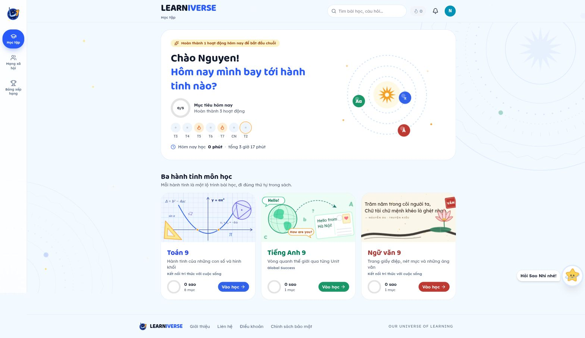
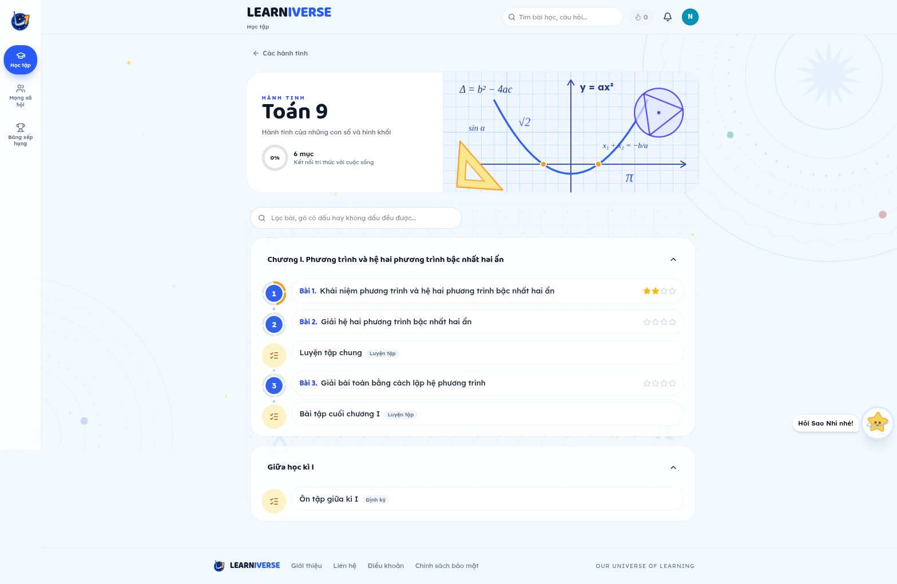
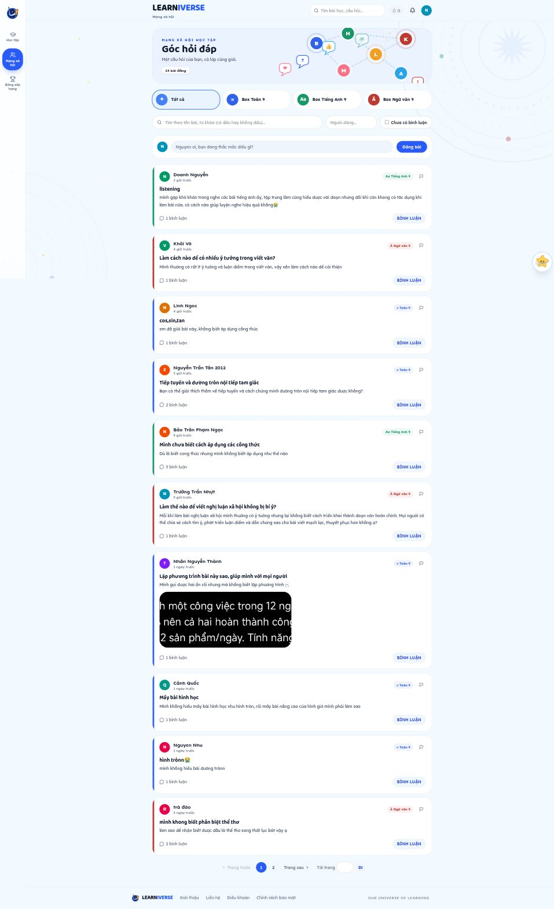
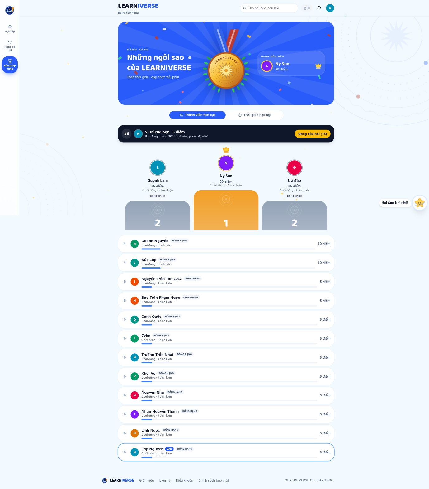
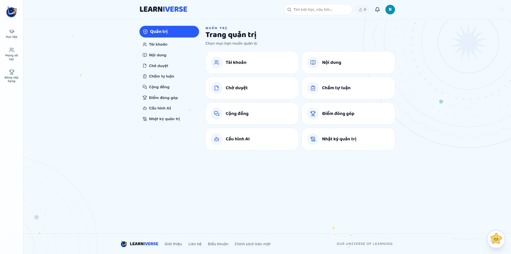

# LEARNIVERSE

**Our universe of learning** - Nền tảng học tập kết hợp mạng xã hội giáo dục cho học sinh lớp 9.

**Website:** https://learniverse.io.vn

---

## Tổng quan

LEARNIVERSE là hệ thống học tập trực tuyến dành cho học sinh lớp 9, bao gồm **ba môn học:**
- **Toán 9**: Hành tinh của những con số và hình khối
- **Tiếng Anh 9**: Vòng quanh thế giới qua từng Unit
- **Ngữ văn 9**: Trăm năm trong cõi người ta, chữ tài chỉ mệnh khó lòng ghét nhau

Chương trình học theo bộ sách **Kết nối tri thức với cuộc sống** (NXB Giáo dục Việt Nam).

### Tính năng chính

#### 🎓 Học tập
- **4 hoạt động cho mỗi bài học:** Lý thuyết, Bài tập, Dạy AI, Ôn tập
- **Hệ thống sao:** Mỗi hoạt động đạt yêu cầu nhận 1 sao, đủ 4 sao = Hoàn thành bài
- **Chuỗi ngày học:** Học mỗi ngày để giữ chuỗi, xây dựng thói quen học tập
- **Ôn tập/Kiểm tra định kỳ:** Có đồng hồ đếm ngược, tự động nộp bài khi hết giờ
- **Bài tự luận:** Viết bài, nộp cho giáo viên chấm, nhận nhận xét

#### 🤖 AI Sao Nhí (Trợ lý học tập)
- Trả lời câu hỏi về bài học (giải thích từng bước, không chỉ đưa đáp án)
- Nhận ảnh bài tập để hỗ trợ giải
- Tạo câu hỏi ôn tập, tóm tắt bài học
- Giới hạn **30 câu hỏi/ngày** và **5 ảnh/ngày** để quản lý chi phí

#### 🎓 Dạy AI (Phương pháp Feynman)
- Học sinh **dạy lại bài cho AI** bằng lời của mình
- 5 lượt giảng, AI chấm điểm và nhận xét
- Đạt từ 7/10 điểm → nhận 1 sao
- Mỗi ngày có **3 phiên** Dạy AI

#### 👥 Mạng xã hội học tập
- Đăng bài hỏi đáp, chia sẻ kiến thức
- Bình luận, thích bài viết
- Đính kèm ảnh (tối đa 5 ảnh/bài)
- Báo cáo nội dung vi phạm
- Hệ thống điểm đóng góp: +5 khi đăng bài có ảnh, +2 khi bình luận

#### 🏆 Bảng xếp hạng
- **TOP 10 Sao:** Học sinh có nhiều sao nhất
- **TOP 10 Đóng góp:** Điểm từ hoạt động cộng đồng
- **TOP 10 Thời gian:** Thời gian mở các trang học tập (tự động tính, không gian lận)
- Hiển thị huy chương vàng, bạc, đồng cho top 3

#### 🛠️ Quản trị
- **Giáo viên:** Soạn nội dung, câu hỏi (gửi duyệt), chấm bài tự luận, kiểm duyệt cộng đồng
- **Admin:** Quản lý tài khoản, duyệt nội dung, cấu hình AI, xem thống kê chi phí AI, nhật ký hệ thống

---

## Giao diện








---

## Kiến trúc hệ thống

LEARNIVERSE được xây dựng theo kiến trúc **tách biệt Frontend và Backend:**

```
┌─────────────────────┐         ┌─────────────────────┐
│  learniverse-web    │────────▶│  learniverse-api    │
│  (Next.js 16)       │  HTTP   │  (FastAPI)          │
│  Giao diện người    │         │  Logic nghiệp vụ    │
│  dùng               │         │  Chấm điểm, cấp sao │
└─────────────────────┘         └──────────┬──────────┘
                                           │
                             ┌─────────────┴─────────────┐
                             ▼                           ▼
                    ┌─────────────────┐       ┌──────────────────┐
                    │   PostgreSQL    │       │  Object Storage  │
                    │   (Database)    │       │  (S3-compatible) │
                    └─────────────────┘       └──────────────────┘
```

---

## Các repository

| Repo | Mô tả | Stack |
|------|-------|-------|
| **[learniverse-web](https://github.com/LEARN-IVERSE/learniverse-web)** | Frontend: Giao diện học sinh, giáo viên, admin | Next.js 16, React 19, TypeScript, Tailwind CSS 4 |
| **[learniverse-api](https://github.com/LEARN-IVERSE/learniverse-api)** | Backend: API, logic nghiệp vụ, chấm bài | FastAPI, Python 3.14, PostgreSQL, SQLAlchemy 2 |

---

## Công nghệ nổi bật

### Frontend (learniverse-web)
- **Next.js 16** (App Router, React Server Components)
- **TypeScript strict mode** + ESLint + Prettier
- **Tailwind CSS 4** + responsive 3 cỡ màn hình (điện thoại, tablet, desktop)
- **Vitest** (unit tests) + **Playwright** (E2E tests)
- **OpenTelemetry** (@vercel/otel) để trace request
- API client tự sinh từ OpenAPI spec

### Backend (learniverse-api)
- **FastAPI** (async, OpenAPI tự động)
- **SQLAlchemy 2** (async ORM) + **Alembic** (migration)
- **Pydantic v2** (validation request/response)
- **PostgreSQL 18** (ràng buộc UNIQUE chống trùng sao/điểm)
- **SeaweedFS** (S3-compatible, dev) / **Cloudflare R2** (production)
- **Google Gemini** (AI assistant, model: gemini-3.5-flash-lite)
- **OpenTelemetry** (FastAPI native + SQLAlchemy instrumentation)
- **pytest** (test coverage), **ruff** (lint), **mypy --strict** (type check)
- **uv** (dependency management)

### Đăng nhập
- **Google Identity Services** (FE) + Backend tự xác minh ID token
- Phiên lưu bằng **HttpOnly cookie** (chống XSS), token hash SHA-256 lưu DB
- Hết hạn: 30 ngày hoặc 7 ngày không hoạt động

### Giám sát
- **OpenTelemetry** end-to-end: FE → BE → SQL
- Jaeger UI (dev), có thể tích hợp Datadog/Grafana (production)
- Nhật ký mọi thao tác quản trị (audit log)

---

## Triển khai

### Development (Local)
```bash
# Terminal 1: API
cd learniverse-api
docker compose up -d          # PostgreSQL, SeaweedFS, Jaeger
uv sync && ./scripts/migrate.sh && ./scripts/seed.sh
uv run fastapi dev app/main.py

# Terminal 2: Web
cd learniverse-web
pnpm install && pnpm gen:api
pnpm dev                      # http://localhost:3000
```
---

## Giấy phép

Mã nguồn của LEARNIVERSE được phát hành dưới giấy phép **MIT License**.

Nội dung bài học (content/*.yaml) và tài liệu giảng dạy tuân theo bản quyền của NXB Giáo dục Việt Nam.

---

<p align="center">
  <strong>🌟 OUR UNIVERSE OF LEARNING 🌟</strong>
</p>

